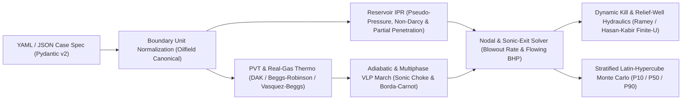

# wellsim

Deterministic steady-state blowout-rate, relief-well dynamic-kill, and Latin-hypercube Monte Carlo simulator for wild-well engineering. Full mathematical specification, validation gates (G1–G4), and paper provenance are in [`docs/`](docs/).



- Internal units are oilfield units (`wellsim/core/units.py`). Conversion happens only at
  the I/O boundary: case inputs may carry units (`"300 bar"`, `{value: 100, unit: degC}`)
  and are stored canonical.
- Cases are pydantic models (`wellsim/cases/schema.py`) loaded from YAML
  (`wellsim/cases/loader.py`). Examples in `wellsim/cases/examples/`.
- `solve(case) -> result` will be a pure function; no global state, no UI in `core/`.

```
.venv\Scripts\python -m pytest
```

Milestones: see `docs/wellsim-stage1-spec.md` section 8. M0: skeleton, schema, units,
test harness. M1: PVT behind `wellsim.core.pvt.PVTModel` (black oil, dry gas), each
correlation unit-tested against published worked examples (gate G1); out-of-range use
raises a `RangeWarning`, collected with `collect_range_warnings()`. Where every test
value came from, and which need a hand check against the original papers, is in
`docs/PROVENANCE.md`.


M2: dry-gas blowout rate end to end. `wellsim.core.solver.solve(case)` returns a `Result`
carrying the rate, flowing BHP, exit state (choked or not), choked-restriction depths, the
pressure profile, the nodal curves, correlation choices, the canonical inputs and every
warning. Pieces: gas IPR with pseudo-pressure and non-Darcy skin (`core/ipr/gas.py`),
flow-path geometry (`core/geometry.py`), linear temperature profile (`core/temperature.py`),
single-phase gas gradient with the acceleration term
(`core/vlp/correlations/single_phase_gas.py`), a marching integrator that is regular through
the sonic point and resets to the sonic pressure at any choked internal narrowing
(`core/vlp/march.py`), the real-gas Mach 1 exit check (`core/exit.py`) and the nodal solver
(`core/nodal.py`), which finds the root of pwf_vlp(q_ipr(pwf)) - pwf between ambient and
reservoir pressure with the IPR capped at its maximum. Results warn
about choked exits and restrictions, defaulted exit temperature, an assumed kv/kh for a
partially penetrating interval (Papatzacos pseudo-skin, `core/ipr/partial_penetration.py`),
and every correlation used outside its published range. Real-gas enthalpy, cp, Joule-Thomson
coefficient and sound speed come from analytic DAK departures (`core/pvt/real_gas_thermo.py`),
gated against NIST methane data; DAK departures run a few percent small, so predicted
temperatures run warm, about 2 to 4 K per throttle in the methane checks. The default
temperature model is adiabatic: the march integrates the coupled momentum and energy
equations, chokes at the adiabatic sound speed, and reports sandface and exit temperatures;
`temperature.model: profile` restores the prescribed linear profile. Wellbore heat transfer
is not modelled, so cooling is overstated at low rates. Gas enters the wellbore after an
isenthalpic throttle from reservoir pressure to the flowing bottomhole pressure
(`temperature.sandface_jt`, default true): a steady-state assumption, since the near-wellbore
rock reaches thermal equilibrium with the flowing gas in minutes to days at blowout rates;
early-time exit temperatures are warmer than reported, and the result notes flag sandface
cooling above 20 degF. States outside the gas region the model represents (Tpr below 1.05
at Ppr above 1, or Tpr below 0.7 or Z below 0.3 at Ppr at or below 1) are refused and treated
as Mach above 1 in the choke searches, never interpolated; the outflow is then reported as
not evaluable rather than computed from a liquid-like density root. Area changes are treated
as sudden: a flow-direction expansion follows the Borda-Carnot momentum balance (choked at the
adiabatic sonic state when no subsonic root exists) and a contraction follows a Crane loss plus
an isentropic deceleration; gradual tapers are not modelled. An exit restriction (`exit.exit_id`)
takes a discharge coefficient `exit.cd` (default 1.0) on its area and is entered as a sudden
contraction from the top conduit, with the Crane loss only when cd is 1.0. The VLP is checked against a published
Cullender-Smith worked example and a nine-well field table; provenance of every expected
value is in `docs/PROVENANCE.md`. Examples: `dry_gas_vertical` (choked exit),
`dry_gas_big_bore_liner` (casing over open hole), `dry_gas_parted_tubing` (choke at an
internal restriction).

```python
from wellsim.cases.loader import load_case
from wellsim.core.solver import solve

r = solve(load_case("wellsim/cases/examples/dry_gas_vertical.yaml"))
print(r.gas_rate, r.pwf, r.exit.p, r.exit.choked, r.warnings)
```

Case-input note: `fluid.gas_sg` is the **well-stream** gas gravity (all produced gas plus the gas
equivalent of any liquid), not the separator gas gravity. The nine-well Cullender-Smith comparison in
`docs/PROVENANCE.md` shows a 5% gravity difference moving bottomhole pressure by about 1.3%.
Deferred physics carried into M3 is listed in `docs/TODO-M3.md`.


mc-1: forward Monte Carlo on blowout rate, static-hold mud weight and kill rate
(`wellsim/core/montecarlo.py`, the optional `mc` case block). Reservoir pressure, net pay,
the open interval and the exit condition (discharge coefficient or restriction diameter)
are sampled as triangulars and kh log-uniform, on a Latin hypercube from a required seed;
permeability is derived, k = kh / net_pay, so beta and the non-Darcy D follow from k as in
the forward solve. Those inputs are the ones a job can defend: offset wells, logs, the
casing tally and the wellhead. A blowout rate read off a flare or a plume is not one of
them and is never an input; when there is a rate estimate it enters as `mc.rate_band`, a
filter on forward samples that says which combinations of the defensible inputs are
consistent with what was seen. The rate pass is one `solve` per sample (processes, never
threads: the range-warning collector swaps a module global and the process-wide warnings
filter); a sample that raises or does not flow is recorded with its reason and never
dropped, and the percentiles come from the survivors only. The static-hold mud weight
(p_r - p_exit)/(0.052 TVD) needs no solve. The kill pass stratifies the survivors into
equal-probability bins of gas rate, takes one from each and runs the dynamic-kill search
at the planned kill density, warm-starting each search from the previous kill rate in its
chain; a chain, not a worker, is the unit of warm-starting, so the answer does not depend
on the worker count. The report (`out/mc_summary.md`) gives the 10th, 50th and 90th
percentiles of gas rate, static-hold mud weight and kill rate, each labeled in words
rather than as a P-number, the fraction of kill samples where the static hold fails, a
Spearman rank correlation of every sampled input against rate and against kill rate, the
percentiles at n/2 against n, and the failures by reason. Example:
`mc_wgr.json` (2,000 samples, 100 kill searches, about 8 minutes on 8 cores).

```python
from wellsim.cases.loader import load_case
from wellsim.core import montecarlo as mc

if __name__ == "__main__":  # the pool spawns on Windows
    r = mc.run(load_case("wellsim/cases/examples/mc_wgr.json"))
    print(mc.write_summary(r))
```


rw-1: relief-well hydraulics for the dynamic kill (`wellsim/core/relief_well.py`, the
optional `relief_well` case block, one relief well). At a kill rate q the pumps must
supply

    p_pump = p_zinj - hydrostatic(string) + friction(string) + friction(surface lines)
             + restriction loss

with p_zinj the blowing well's own pressure at the injection depth at the kill condition.
That pressure comes from the kill search rather than from a second model of the blowing
well: at the minimum kill rate the well has no roots, so there is no operating point, and
the state taken is the one at the residual minimiser, where the outflow curve touches the
inflow curve. The injection string is given as (MD, TVD) stations, the same pair the well
survey uses, so a deviated relief well gets its hydrostatic from the vertical drop and its
friction from the measured length; surface lines are horizontal and carry friction only.
The end restriction is exactly one of a bit total flow area (dp = rho q^2 / (12031 TFA^2))
or an intersection loss coefficient (dp = K rho v^2 / (2 g_c) at the string ID) -- there is
no default, because a missing loss spec is worth hundreds of psi of pump pressure.

The kill fluid warms on the way down the relief string, and how warm it arrives at the
injection point moves the kill rate by a few percent. rw-2 computes that arrival
temperature rather than bracketing it: Ramey (1962) for downward single-phase flow,
dT/dL = (T_g - T)/A with A = w c_p f(t) / (2 pi k_e), integrated along the string in
measured depth (heat transfer is per unit of pipe) with the formation temperature taken
from TVD, so a deviated string works, and solved in closed form segment by segment. It is
a bound, not an estimate: that A is the U to infinity limit, which drops the pipe, annulus
and cement resistance and so makes the fluid relax toward the formation as fast as it
physically can, giving the highest arrival temperature available. The surface temperature
is the matching lower bound. Both kill rates are reported with the gap; the reported one
is the hotter, higher-rate end. rw-3 then turns that bound into an estimate by giving the
overall heat transfer coefficient its finite value: three resistances in series per unit
length, the inside film from Dittus-Boelter, the pipe wall, and the cement annulus (or the
formation itself over an uncemented interval), referred to the string OD. A carries the
string's own resistance as well as the formation's, so

    A = w c_p (k_e + r_to U f(t)) / (2 pi r_to U k_e)

which is the rw-2 bound as U goes to infinity and the inlet temperature as U goes to zero.
Three injection temperatures are reported and the middle one is the answer: on the shipped
example the kill fluid arrives at 64.0 degF against a bound of 82.8 degF and a surface
temperature of 60.0, giving 26.3647 bbl/min between 26.1604 and 26.7767, so 0.78% below and
1.56% above the estimate.

The cement annulus turns out to be 99% of the resistance on that string, so the estimate
sits near the cold end of the bracket rather than in the middle, and the cement
conductivity is the input that now carries the answer; it defaults to 0.7 Btu/(hr ft degF)
with a warning, and sweeping it from 0.1 to 100 moves the arrival temperature from 60.7 to
81.5 degF.

Pump pressure rises monotonically with rate, so there is one rate at which the balance
reaches atmospheric. Below it the string is on vacuum: the kill fluid free-falls and the
surface pressure does not control the rate. That rate is reported, and a negative pump
pressure is never presented as a number to size a pump against -- the balance value is
kept as a diagnostic and the reported pump pressure is zero gauge with the sentence
attached. A pump schedule runs from the kill rate to 1.5 times it, each row flagged
against the pump and rating limits. With a `mc` block as well, every Monte Carlo kill
sample also reports its pump pressure, horsepower and arrival temperature, and the
fraction of samples on vacuum or over a limit, with no extra kill searches. Example:
`rw_wgr.json`.

Two things the relief-well work turned up are recorded in `docs/TODO-M4.md` rather than
papered over: the published Hasan-Kabir time function f(t_D) is not continuous at
t_D = 1.5 (the two branches differ by 2.44%, and the coefficients are left as published
with the jump pinned by a test), and `min_kill_rate` was not start-independent to its
stated 1% tolerance. The second is fixed (ks-2): the scan gate that could certify a
still-flowing rate as killed is gone, the Brent tolerance is relative to the root rather
than to the bracket, and an always-on check proves the returned rate kills while one
tolerance step below it does not. Four warm starts now agree to 0.44%.

```python
from wellsim.cases.loader import load_case
from wellsim.core.solver import solve

r = solve(load_case("wellsim/cases/examples/rw_wgr.json"))
rw = r.kill["relief_well"]
print(rw["p_zinj_psia"], rw["at_kill"]["p_pump_psig"], rw["at_kill"]["hhp"])
```


## Interactive Well Control Simulator & Training Console

`wellsim` includes a full time-domain transient simulator and zero-dependency web console designed for IADC WellSharp / IWCF well control training, real-time kick detection, and choke operations:

```bash
# Launch interactive simulator web console on port 8080
python -m wellsim.ui 8080
```

Open `http://localhost:8080` in any modern web browser to access:
- **Gauges & Strip Charts**: Real-time 60-second scrolling telemetry for Standpipe Pressure (SPP), Casing Pressure (CP / SICP), Pit Volume Gain, Flow Out %, Mud Density In/Out, and Pump SPM.
- **Remote Choke Panel**: Step-by-step digital choke controls (±1%, ±5%) with choke position indicator and target pressure tracking.
- **PID Auto-Choke**: Closed-loop hydraulic feedback maintaining constant BHP during kill mud circulation.
- **Audible Rig Alarms**: Audio synthesizer triggers alerts on kick detection (>10 bbl gain) and MAASP exceedance warnings.
- **Kill Sheet Generator & Export**: Auto-computes Kill Mud Weight (KMW), Initial Circulating Pressure (ICP), Final Circulating Pressure (FCP), MAASP, and Driller's Method step-down schedules with direct Markdown kill sheet downloads (`/api/killsheet/export`).
- **IADC WellSharp Teaching Engine**: Pre-configured interactive scenarios (Kick Detection, Soft Shut-in, Driller's Method First Circulation, Second Circulation) with automated step criteria grading and feedback.

### Batch Sweeps and Sensitivity (M7)

Automated parameter sweeping and tornado sensitivity analysis are available via `wellsim.batch.sweep`:

```python
from wellsim.cases.loader import load_case
from wellsim.batch.sweep import sweep_parameter, tornado_sensitivity

case = load_case("wellsim/cases/examples/dry_gas_vertical.yaml")
sweep = sweep_parameter(case, "reservoir.permeability", [20.0, 50.0, 100.0, 200.0])
print(sweep.to_markdown())
```

### Advanced Physics & Next-Gen Drilling Capabilities

`wellsim` includes state-of-the-art physics modules engineered to exceed legacy industry software (e.g., SLB Drillbench). For detailed technical specifications, equations, and literature citations, see [`docs/next-gen-capabilities.md`](docs/next-gen-capabilities.md).

- **Herschel-Bulkley (Yield-Power-Law / YPL) Rheology & HPHT Scaling** (`wellsim.core.rheology`): Full API RP 13D 3-parameter fluid characterization ($\tau = \tau_0 + K \dot{\gamma}^n$) fitted directly from Fann rotational viscometer dial readings, with Fann 75/77 downhole thermal-thinning and piezo-thickening viscosity corrections.
- **OBM / SBM Gas Solubility & Flash Exsolution** (`wellsim.core.obm_solubility`): Non-aqueous drilling fluid (NADF) kick dynamics modeling complete methane dissolution downhole ($P > P_b$) with zero free gas, followed by explosive near-surface flash vaporization and annular unloading upon reaching the bubble point.
- **Dynamic Surge & Swab Tripping Engine** (`wellsim.core.surge_swab`): Burkhardt & Mitchell pipe tripping models computing maximum safe running-in (RIH) and pulling-out (POOH) velocity envelopes to prevent casing shoe fracture or swab-induced reservoir kicks under both open-ended and closed-ended float valve conditions.
- **Managed Pressure Drilling (MPD) Suite** (`wellsim.core.mpd`): Coriolis flow meter mass-balance micro-flux detection (0.5 to 1.5 bbl thresholds), automated Constant Bottomhole Pressure (CBHP) surface backpressure (SBP) regulation PID loops, and deepwater subsea choke/kill line friction backpressure modeling.
- **Live WITS Level 0 Telemetry** (`wellsim.core.wits`): Real-time WITS0 encoder/decoder streams enabling `wellsim` to operate as a live digital twin or hardware-in-the-loop (HIL) simulator feeding drilling cyberbase consoles via `/api/wits`.
- **Dynamic Cuttings Transport & Hole Cleaning** (`wellsim.core.cuttings_transport`): Larsen / API RP 13D 3-layer solids transport engine modeling slip velocity, critical transport velocity, stationary cuttings bed accumulation, annular choking, and mechanical pack-off risk in directional and horizontal wells (0° to 90° inclination).
- **Comparative Well Control Strategy Matrix** (`wellsim.core.kill_comparison`): Side-by-side benchmark comparing Driller's Method (2-circ), Wait & Weight (1-circ), Volumetric Lubricate & Bleed, and Dynamic Bullheading across peak casing pressure, casing shoe breakdown stress, and execution duration.
- **Minimum Curvature 3D Directional Trajectory Engine** (`wellsim.core.survey`): Industry standard survey calculation mapping raw $(MD, Inc, Azm)$ stations into 3D spatial $(TVD, North, East, DLS)$ coordinates with JSON coordinates exported for 3D web visualizations.
- **3D Torque & Drag and Drillstring Buckling** (`wellsim.core.torque_drag`): Johancsik soft-string tension, torque, and normal force integration with Dawson-Paslay / Wu sinusoidal & helical buckling thresholds and ERD lock-up depth determination.
- **Rig Telemetry Anomaly Detector & Early Warning** (`wellsim.core.anomaly_detection`): Real-time detector flagging drilling breaks, bit nozzle plugging vs. drillstring washout signatures ($SPP/SPM^2$), and differential sticking vs. mechanical pack-off classification.
- **Historical Blowout Benchmark Library**: Pre-calibrated wild-well intervention cases including Macondo MC252 (G5 deepwater oil blowout), Aliso Canyon SS-25 (underground storage parted casing), and Montara H1-ST1 (offshore Timor Sea platform blowout).
- **Headless Production CLI** (`wellsim`): Direct command-line interface for CI/CD and batch execution (`wellsim run case.yaml`, `wellsim check case.yaml`, `wellsim sweep case.yaml param v1 v2 ...`).
- **Deepwater Gas Hydrate Formation & Inhibitor Dosing** (`wellsim.core.hydrates`): Sloan / Towler thermodynamic equilibrium model predicting hydrate freezing risk in subsea BOP and choke lines with automated Hammerschmidt dosing calculations for Methanol and MEG inhibitors.
- **Underground Blowout & Cross-Flow Engine** (`wellsim.core.crossflow`): Coupled multi-formation internal hydraulics solving steady-state cross-flow from deep overpressured source reservoirs into ruptured thief zones, and sizing required dynamic relief-well kill rates.
- **Dynamic Wellbore Heat Transfer** (`wellsim.core.hasan_kabir`): Hasan & Kabir (1994) / Ramey conjugate convection-conduction engine calculating exact counter-current drillpipe and annular temperature profiles along the wellbore over circulating time.
- **API Spec 5CT Casing Structural Integrity Screening** (`wellsim.core.casing_integrity`): Full burst and collapse mechanical ratings under API Spec 5CT Barlow and API TR 5C3 (yield, plastic, transition, and elastic collapse) with dynamic safety factor screening during gas kicks and complete casing evacuation.
- **Wellbore Ballooning / Breathing vs. Kick Discriminator** (`wellsim.core.ballooning`): Geomechanical fracture compliance and poroelastic relaxation engine analyzing flowback decay rates ($dq/dt < 0$ vs sustained $q_{kick}$) and asymptotic gain convergence to prevent false well shut-ins or catastrophic underbalanced kicks.
- **Energistics WITSML 1.4.1.1 XML Telemetry** (`wellsim.core.witsml`): Bi-directional XML serialization and parsing for directional trajectory and wellbore tubular geometry schemas, enabling seamless enterprise integration with real-time drilling data hubs (Kongsberg SiteCom, SLB InterACT, Baker Hughes ADVANTAGE).
- **Interactive 3D Spatial Trajectory Orbit Viewer**: Zero-dependency WebGL/Canvas perspective engine integrated directly into the web console with mouse orbit rotation, dogleg severity color gradients, live casing stress monitors, and one-click WITSML 1.4 XML export.
- **Deepwater Riser Gas Handling & Diverter Routing** (`wellsim.core.riser_gas`): API RP 16Q & API Standard 53 marine riser gas dynamics modeling rapid Boyle/real-gas expansion, slip velocity, liquid mud ejection rates, subsea RGHS annular isolation, MGS Poor Boy liquid-seal blow-through screening, and multiphase diverter line friction backpressure.
- **Dual-Gradient Drilling (DGD) & Subsea MudLift Pump (MLP)** (`wellsim.core.dual_gradient`): Deepwater narrow-margin drilling engine modeling seawater in the marine riser and heavy mud in the subsea wellbore, subsea MudLift Pump pressure regulation at the seabed ($P_{suction} = 0.052 \cdot \rho_{sw} \cdot WD$), MRL lift hydraulics, HHP sizing, and drillpipe-to-annulus U-tube imbalance / Drillstring Valve (DSV) cracking pressure.
- **Managed Pressure Cementing & API RP 65-2 Gas Migration** (`wellsim.core.cementing`): Transient U-tubing ("free-fall") simulation during slurry placement (casing vacuum, return rate surges, and annular ECD vs. fracture limit) and post-placement Static Gel Strength (SGS) development ($100 \to 500\text{ lbf/100 ft}^2$) evaluating annular gas channeling risk and MPC surface backpressure requirements.
- **Real-Time Unscented Kalman Filter (UKF) Digital Twin** (`wellsim.core.kalman`): Pure Python Sigma-Point nonlinear state estimator assimilating noisy WITS/WITSML rig telemetry (SPP, Casing Pressure, Pit Level, Flow Paddle) to dynamically infer downhole formation pore pressure ($P_{pore}$), kick volume ($V_{kick}$), and hydraulic friction factor multipliers with 95% confidence bounds.
- **Production Containerization**: Multi-stage minimal `Dockerfile` and `docker-compose.yaml` for instant zero-dependency deployment on cloud VMs or offshore rig edge servers (`docker compose up`).
- **Printable Official IADC WellSharp Kill Sheet**: Authentic certificate-ready training kill sheet with automated calculations and drillpipe step-down schedule (`/api/killsheet/print`).


